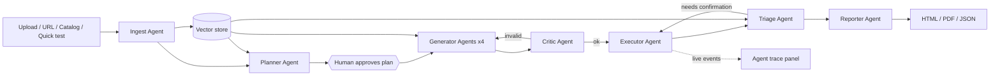

# AI-Based API Testing Platform — Analysis & Upgrade Design

Scope: full read of backend (`app/ai`, `parsers`, `generators`, `executor`, `analyzer`, `reports`, `db`, `api`) and frontend structure. About 9.8k lines of Python/TypeScript (excluding `.agents/`).

---

## 1. Current workflow (as implemented)

```
Upload spec ─► Parse ─► Generate tests ─► Run tests ─► Analyze ─► Report
 (OpenAPI/      prance +    1 LLM call per     asyncio.gather    1 LLM call     Jinja2 →
  Postman)      validator;  endpoint×category  + httpx +         per result,    HTML/PDF
                Postman →   (4 categories),    assertions        sequential
                pseudo-     JSON out, cached
                OpenAPI
```

| Stage | Where | What it does today |
|---|---|---|
| Parse | `parsers/openapi.py`, `postman.py` | Resolves `$ref`, validates, extracts endpoints; Postman is converted to a skeleton OpenAPI |
| Generate | `generators/*`, `prompts/*.j2` | Functional / edge / malformed / security (OWASP API 2023) generators, each one LLM call per endpoint, strict-JSON output, Mongo cache |
| AI layer | `ai/orchestrator.py`, `providers/` | OpenRouter + NVIDIA NIM, retry, primary→fallback |
| Execute | `executor/engine.py`, `runner.py` | Semaphore concurrency, token bucket, retries, status/header/jsonpath/schema assertions |
| Analyze | `analyzer/engine.py` | One LLM call per passed/failed result → risk level, findings, false-positive likelihood |
| Report | `reports/generator.py` | Jinja2 HTML, WeasyPrint PDF |
| UI | `frontend/src/pages/*` | Specs, test cases, runs (2s polling), reports, settings |

**Core limitation for your goal:** it is a *linear pipeline*. The LLM is only used as a text-to-JSON function. There is no retrieval (the LLM never sees OWASP knowledge, other endpoints, or past results), no planning, no feedback loop (a bad test case is saved as-is), and no state shared between steps. That is exactly what RAG + agents fix.

---

## 2. Defects found in the current code (fix first)

Verified by reading the code.

| # | Severity | Issue | Location |
|---|---|---|---|
| 1 | High | **Reports cannot generate**: loader points to `reports/templates/`, which does not exist (only `styles/report.css` ships) → `TemplateNotFound` | `reports/generator.py` |
| 2 | High | **Prompt templates path is CWD-relative** (`"backend/app/generators/prompts"`). README starts uvicorn from `backend/`, so templates are not found and generation fails per endpoint (errors are caught and only logged) | `generators/base.py` |
| 3 | Medium | **Generation cache never hits**: orchestrator passes `str(spec_id)`, the cache stores `ObjectId` | `generators/orchestrator.py`, `db/repositories/specs.py` |
| 4 | Medium | **Analyzer ignores Settings page** (provider/model/key): it calls `create_orchestrator()` with no arguments | `analyzer/engine.py` |
| 5 | Medium | `ProviderError(code=…, message=…)` in analyzer omits required `provider` → `TypeError` on that path | `analyzer/engine.py` |
| 6 | High | **Results are written only after all tests finish** (`bulk_create` after `gather`), so the "real-time progress" in the README is not real; summary counters also update only at the end | `executor/runner.py` |
| 7 | Medium | **Malformed-JSON / wrong-content-type tests cannot really be sent**: executor uses `json=`, which always re-serialises valid JSON | `executor/engine.py` |
| 8 | Medium | `response_time` assertion type always returns `False` | `executor/assertions.py` |
| 9 | Medium | Auth supports only a *server-side env var name* → bearer; no way to type a token in the UI, no API-key/basic auth, and a single identity means **BOLA/BFLA tests cannot be validated** | `executor/engine.py`, `db/models.py` |
| 10 | High | **No target safety**: the executor will call any URL (localhost, private ranges, cloud metadata IPs) and send attack payloads to any host | `executor/engine.py` |
| 11 | High | AI API keys are stored in plaintext in the user document and in browser `localStorage` | `Settings.tsx`, `users` collection |
| 12 | Low | `rate_limit_rps` setting exists but runner hard-codes `rate_limit_rps=None`; `duration_seconds` never set; both branches of `final_status` are identical | `executor/runner.py` |
| 13 | Low | Work runs in FastAPI `BackgroundTasks` — lost on restart, no resumability | `routes/*.py` |
| 14 | Low | `_extract_endpoints` copy-pasted in 3 places; 4 generators repeat identical `parse_response`; Postman `{{baseUrl}}` never resolved; `yaml` imported but not declared in `pyproject.toml`; only 7 unit tests | various |
| 15 | Low | `.agents/AGENTS.md` links are absolute paths from another machine | `.agents/AGENTS.md` |

---

## 3. Target architecture

### 3.1 Same steps, agentic execution

| Current step | New agent | What changes |
|---|---|---|
| Parse | **Ingest Agent** | Same parsers + builds an endpoint dependency graph (e.g. `POST /users` produces the id used by `GET /users/{id}`), **indexes the spec into the vector store** |
| *(none)* | **Planner Agent** | New. Uses RAG to decide per endpoint which categories matter, priorities, auth needs, ordering. Human approves the plan |
| Generate | **Generator Agents** ×4 (functional, edge, malformed, security) | Same categories and JSON schema, but prompts are grounded with retrieved spec chunks + OWASP knowledge; output carries `rag_sources` |
| *(none)* | **Critic Agent** | New. Validates every test case (schema, spec conformance, duplicates, safety); sends failures back to the generator for repair (max 2 loops) |
| Execute | **Executor Agent** (mostly deterministic) | Variable chaining between calls, per-test live events, mode-aware safety guard, pauses for human input if auth is missing |
| Analyze | **Triage Agent** | Batched + RAG-grounded; classifies each failure as *real bug / test bug / spec drift / flaky / environment*; may request one re-run to confirm |
| Report | **Reporter Agent** | Executive summary, OWASP-mapped findings with citations, remediation; HTML/PDF/JSON |
| *(none)* | **Assistant (chat)** | Optional. "Ask about this run" RAG chat over spec + results |



Orchestration: **LangGraph `StateGraph`** with a Mongo checkpointer (resumable sessions, human-in-the-loop interrupt at plan approval and at "auth needed"). Every node emits events (`agent`, `step`, `status`, `tokens`, `latency`, `provider`, `model`, `rag_sources`) over **SSE** to the UI.

### 3.2 RAG design

| Collection | Content | Used by |
|---|---|---|
| `spec_chunks` | One chunk per endpoint (method, path, params, request/response schema, auth) and per component schema | Planner, Generators, Triage |
| `owasp_kb` | Your own concise write-ups of each OWASP API Top 10 2023 risk: how to probe, what a vulnerable vs safe response looks like | Security generator, Triage, Reporter |
| `http_kb` | Status-code semantics, REST conventions, common assertion patterns | Functional/Edge/Malformed generators |
| `run_memory` | Past failures, confirmed bugs, false positives per spec (embedded summaries) | Planner, Triage |
| `user_docs` | Optional uploads: API docs, README, business rules | Planner, Generators |

- **Vector store:** ChromaDB persistent directory (zero infrastructure), behind a `VectorStore` interface so it can be swapped.
- **Embeddings:** local by default (Ollama `nomic-embed-text` or `sentence-transformers/all-MiniLM-L6-v2`), cloud optional. Record the embedding model per collection; re-index if it changes.
- **Retrieval:** top-k 6, metadata filter (`spec_id`, `endpoint_id`, `collection`), optional hybrid with BM25. Retrieved chunk ids are stored in each test case and finding (`rag_sources`) so the UI can show "why".
- Write the OWASP/HTTP knowledge in your own words (short Markdown files in `app/rag/kb/`); do not paste copyrighted text.

### 3.3 Third-party AI + local LLM

Add one `OpenAICompatProvider(base_url, api_key, model)`. Ollama, LM Studio, llama.cpp server and vLLM all expose `/v1/chat/completions`, as do OpenRouter, NVIDIA NIM, OpenAI, Groq, Together. So `nim.py` and `openrouter.py` collapse into presets of one class.

| Policy | Behaviour |
|---|---|
| `local_only` | Nothing leaves the machine (use for sensitive specs and for the privacy argument in the COE demo) |
| `cloud_only` | Third-party provider only |
| `local_first` | Local model; fall back to cloud on invalid JSON after N repairs |
| `cloud_first` | Cloud; fall back to local on rate limit/outage |
| `per_agent` | e.g. Planner + Reporter on a strong cloud model, Generators + Triage on local |

Small local models break strict JSON. Mitigation built into the base agent: JSON mode / schema where supported → `json-repair` → Pydantic validation → retry with the validation error appended (max 2). Per-model capability flags (`json_mode`, `json_schema`, `tools`, `context_window`) decide the strategy; use JSON-ReAct prompting instead of native tool-calling for local models.

### 3.4 Two testing modes

| | **Local API test** | **Online free API test** |
|---|---|---|
| Targets | `localhost`, `127.0.0.1`, `host.docker.internal`, LAN/RFC1918 — your own API, or the bundled **VulnShop** demo | Public sandbox APIs from a catalog (JSONPlaceholder, httpbin, DummyJSON, Restful-Booker, Swagger Petstore, PokeAPI …) or a host you attest you own/are authorised to test |
| Spec source | File upload, or auto-discover `http://localhost:PORT/openapi.json` | Catalog entry (bundled OpenAPI), URL import, file upload |
| Categories | All four, including full security suite | Functional, edge, malformed on by default; **security payloads and resource-consumption tests off** unless host is in the "owned" allow-list |
| Intensity | Up to 20 concurrent, no rate cap | ≤3 concurrent, ≤2 req/s, hard cap on total requests, honours `429`/`Retry-After` |
| Safety guard | Allows loopback/private only | **Blocks** loopback, private, link-local, metadata IPs (resolved by DNS, re-checked per redirect) |
| Why | Deep testing, safe seeded vulnerabilities for demos | Zero-setup demo anywhere, no local API required |

Rule for both modes: a host is rejected unless it passes `TargetGuard`. Online mode never fires attack payloads at third-party services you do not own.

---

## 4. COE-ready extras (what makes it a research-grade demo)

1. **Agent Trace panel** — live, step-by-step view of each agent (inputs, retrieved chunks, tokens, latency, provider/model).
2. **VulnShop demo target** — small FastAPI app with *known, seeded* flaws (BOLA, BFLA, mass assignment, missing auth, verbose errors, no pagination limit, SSRF-style URL param). Gives you ground truth.
3. **Evaluation harness** — run the pipeline against VulnShop with different configurations and report: valid-test rate, valid-JSON rate, vulnerability **recall/precision**, false-positive rate, tokens, latency, cost.
4. **Ablation table** for the report/slides: baseline (current pipeline) vs +RAG vs +RAG+critic vs +RAG+critic+triage; and local-model vs cloud-model.
5. **Privacy argument** — `local_only` mode runs end-to-end with no external calls.

---

## 5. Suggested presentation storyline

1. Problem: manual API testing is slow; naive LLM test generation is inconsistent and unsafe.
2. Baseline: the existing linear pipeline and its measured weaknesses.
3. Contribution: RAG grounding + multi-agent loop (plan → generate → critique → execute → triage → report).
4. Dual AI: cloud vs local, routing policies, privacy.
5. Dual modes: local deep testing vs safe online sandbox testing.
6. Live demo: VulnShop run → agent trace → findings → report.
7. Results: ablation + local-vs-cloud table.
8. Limitations and future work (authenticated multi-user flows, CI integration, code-aware RAG).
