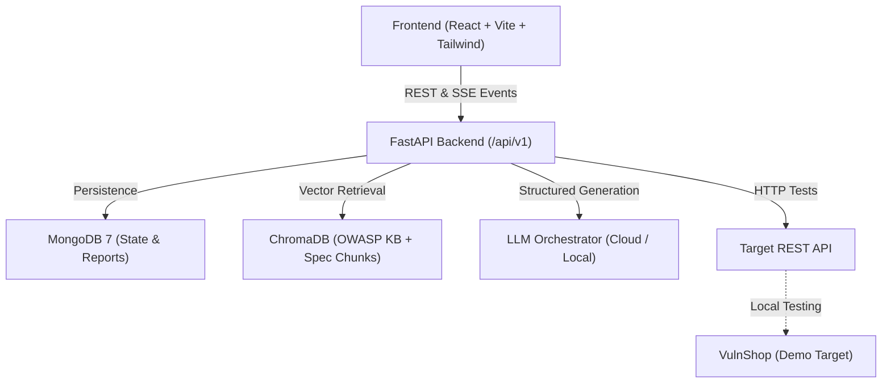

# Autonomous AI-Powered API Testing Platform

[](https://python.org)
[](https://fastapi.tiangolo.com)
[](https://react.dev)
[](https://www.typescriptlang.org)
[](https://tailwindcss.com)
[](https://trychroma.com)
[](https://mongodb.com)
[](LICENSE)

An enterprise-grade, autonomous API testing and security auditing platform. It leverages autonomous LLM agents, Retrieval-Augmented Generation (RAG) over the OWASP API Security Top 10 (2023), robust multi-provider LLM routing (cloud & local), strict network target safety guards, and live Server-Sent Events (SSE) tracing.

---

## Key Highlights

- **Autonomous Agentic Pipeline (`AGENTIC_MODE`)**: Multi-agent graph (Ingest → Plan → Interrupt for Human Approval → Execute → Triage → Report) with real-time SSE event streaming.
- **Dual Pipeline Architecture**: Supports both the autonomous agent graph and the high-throughput legacy linear pipeline for A/B evaluation and benchmarking.
- **RAG Knowledge Base**: Integrated ChromaDB vector store indexing the complete OWASP API Security Top 10 (2023), RFC HTTP standards, spec parameter/schema chunks, and confirmed bug run memory.
- **Multi-Provider LLM Routing**: Unified OpenAI-compatible provider layer supporting Cloud models (OpenRouter, NVIDIA NIM) and fully local private offline models (Ollama, LM Studio, llama.cpp).
- **Target Safety Guard (`TargetGuard`)**: Enforces Local vs. Online policy boundaries. Blocks private RFC1918 subnets, loopback (127.0.0.1), and cloud metadata IP (169.254.169.254) in Online mode, with strict rate limiting and owned-host attestation.
- **Zero Secrets Leakage**: API keys and tokens are encrypted at rest with Fernet (`SECRETS_ENCRYPTION_KEY`), exposed only as write-only flags (`has_key: bool`), and prohibited from client-side `localStorage`.
- **Built-in Demo Vulnerable Target (`VulnShop`)**: Standalone vulnerable e-commerce store with 7 documented OWASP vulnerabilities (BOLA, BFLA, Mass Assignment, Debug Exposure, Unbounded Listing) and ground truth scoring.
- **Evaluation Harness**: CLI benchmarking harness (`backend/eval/run_eval.py`) that executes test runs and calculates precision, recall, and F1 score against ground truth.

---

## Architecture Overview



### Execution Modes

| Feature | LOCAL Mode | ONLINE Mode |
|---|---|---|
| **Primary Use Case** | Local development, Docker services, VulnShop | Public staging and production APIs |
| **Loopback (`127.0.0.1`, `localhost`)** | Allowed | **Blocked** |
| **Private RFC1918 (`10.*`, `172.16.*`, `192.168.*`)** | Allowed | **Blocked** |
| **Cloud Metadata (`169.254.169.254`)** | **Blocked** | **Blocked** |
| **Public Hosts** | Blocked | Allowed |
| **Rate Limit** | Configurable / None | Max 2 requests/sec |
| **Max Concurrency** | Configurable (default 10) | Hard capped at 3 |
| **Owned Host Attestation** | Not required | Required for security attack scans |

---

## Tech Stack

### Backend
- **FastAPI**: Async ASGI web framework
- **MongoDB + Motor**: High-throughput async database driver
- **ChromaDB**: Embedding vector store for semantic retrieval
- **Pydantic v2**: Type enforcement & schema validation
- **cryptography (Fernet)**: AES-128-CBC encryption for provider secrets
- **httpx**: Async HTTP client for test executions and target guard validation
- **WeasyPrint & Jinja2**: PDF and HTML vulnerability report rendering
- **pytest & ruff**: Automated testing suite and linting

### Frontend
- **React 18 + TypeScript**: Type-safe single-page interface
- **Vite**: Modern frontend bundling and development server
- **Tailwind CSS v3**: Clean UI styled according to RCT design system tokens
- **Phosphor Icons**: Consistent icon sets for state representation
- **React Router v6**: Client-side routing with protected route guards
- **EventSource (SSE)**: Real-time agent execution trace streaming

---

## Quick Start

### Prerequisites
- Python 3.11+
- Node.js 18+
- MongoDB 7+
- (Optional) Docker & Docker Compose

---

### Method 1: Local Development

#### 1. Configure Environment
```bash
git clone <repo-url>
cd COE
cp .env.example .env
# Edit .env: Set SECRET_KEY (min 32 chars) and your AI provider keys
```

#### 2. Start MongoDB
```bash
mongod --dbpath ./data/mongo
# Or run with Docker:
docker run -d -p 27017:27017 --name mongodb mongo:7
```

#### 3. Backend Setup
```bash
cd backend
python -m venv venv
source venv/bin/activate  # On Windows: venv\Scripts\activate
pip install -e ".[dev]"

uvicorn app.main:app --reload --host 0.0.0.0 --port 8000
```

#### 4. Frontend Setup
```bash
cd frontend
npm install
npm run dev
# Open http://localhost:5173
```

#### 5. (Optional) Start VulnShop Demo Target
```bash
cd demo_targets/vulnshop
pip install -r requirements.txt
uvicorn main:app --port 8001
```

---

### Method 2: Docker Compose

To launch all services (MongoDB, Backend, Frontend, and VulnShop) simultaneously:

```bash
docker compose up -d

# To include a local Ollama instance:
docker compose --profile ollama up -d
```

---

## Platform Features & Pages

| Page | Route | Description |
|---|---|---|
| **Dashboard** | `/` | Metrics overview, recent test sessions, quick action cards. |
| **New Session Wizard** | `/sessions/new` | 5-step wizard to select Mode (Local/Online), Spec source (Catalog, VulnShop, URL import, file upload), Auth & secondary identity, AI provider, and scope. |
| **Agent Trace View** | `/sessions/:id` | Live Server-Sent Events (SSE) trace displaying agent timeline, latency, tokens, RAG context, and interactive Plan Approval interrupts. |
| **Quick Test** | `/quick-test` | Single-request runner executing through TargetGuard safety policies with header, latency, and status inspection. |
| **Knowledge Base** | `/knowledge-base` | Vector search explorer over the OWASP API Top 10 (2023) and HTTP standards with manual re-indexing trigger. |
| **Specifications** | `/specs` | Upload OpenAPI (JSON/YAML) or Postman collections; import directly from URL. |
| **Settings** | `/settings` | Manage encrypted AI Provider Profiles (OpenRouter, NIM, Ollama, LM Studio) and latency test connections. |
| **Reports** | `/reports` | Executive HTML and PDF vulnerability reports with OWASP classifications and remediation advice. |

---

## API Reference (Selected Endpoints)

All API endpoints are prefixed with `/api/v1`:

### Sessions & Agent Pipeline
- `POST /api/v1/sessions` — Initialize autonomous test session
- `GET /api/v1/sessions` — List user sessions
- `GET /api/v1/sessions/{id}` — Session detail
- `GET /api/v1/sessions/{id}/events` — SSE live event stream (supports `token` query auth)
- `POST /api/v1/sessions/{id}/approve-plan` — Human-in-the-loop plan approval / modification
- `POST /api/v1/sessions/{id}/provide-auth` — Mid-run encrypted auth provision
- `POST /api/v1/sessions/{id}/cancel` — Cancel active session

### AI Providers & Routing
- `GET /api/v1/providers` — List configured profiles (keys masked)
- `POST /api/v1/providers` — Create encrypted provider profile
- `PATCH /api/v1/providers/{id}` — Update profile
- `DELETE /api/v1/providers/{id}` — Delete profile
- `POST /api/v1/providers/{id}/test` — Perform real-time connectivity & latency probe
- `GET /api/v1/providers/presets` — List provider presets (Ollama, LM Studio, etc.)
- `GET /api/v1/providers/ollama/models` — Query local Ollama model catalog

### Specifications & Catalog
- `GET /api/v1/catalog` — List bundled public APIs (JSONPlaceholder, httpbin, DummyJSON, PokeAPI)
- `POST /api/v1/catalog/{id}/import` — One-click import bundled catalog specification
- `POST /api/v1/specs/from-url` — Import spec from remote URL with TargetGuard validation
- `POST /api/v1/quick-test` — Execute single sandboxed test request

### Knowledge Base (RAG)
- `GET /api/v1/kb/status` — Document and chunk counts across collections
- `POST /api/v1/kb/reindex` — Background full re-index of markdown KB
- `GET /api/v1/kb/search` — Semantic vector search across KB

---

## Evaluation & Benchmarking

The platform includes an automated evaluation harness to verify vulnerability detection against ground truth.

```bash
cd backend
source venv/bin/activate

# Execute eval against VulnShop
python eval/run_eval.py eval/configs/baseline_cloud.yaml
```

**Metrics Calculated:**
- **Recall**: Percentage of known vulnerabilities detected
- **Precision**: Ratio of true vulnerabilities vs false positives
- **F1 Score**: Harmonic mean of precision and recall

---

## Verification & Testing

```bash
# Run backend pytest suite (19 unit & safety tests)
cd backend
source venv/bin/activate
pytest tests/ -v

# Run backend linter & formatter
ruff check app/ tests/
ruff format --check app/ tests/

# Run frontend production build
cd ../frontend
npm run build
```

---

## Documentation

- **[Detailed Run Guide](file:///home/koushiknayakau/Desktop/COE/RUN_GUIDE.md)**: Step-by-step setup and VulnShop audit walkthrough.
- **[System Architecture](file:///home/koushiknayakau/Desktop/COE/docs/ARCHITECTURE.md)**: Deep dive into agent graph flows, RAG architecture, and safety policies.
- **[Analysis & Specification](file:///home/koushiknayakau/Desktop/COE/01_ANALYSIS_AND_DESIGN.md)**: Full requirements and design document.

---

## License

This project is licensed under the MIT License — see the [LICENSE](LICENSE) file for details.
This project is licensed under the MIT License — see the [LICENSE](LICENSE) file for details.
