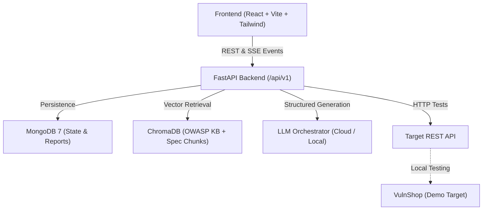
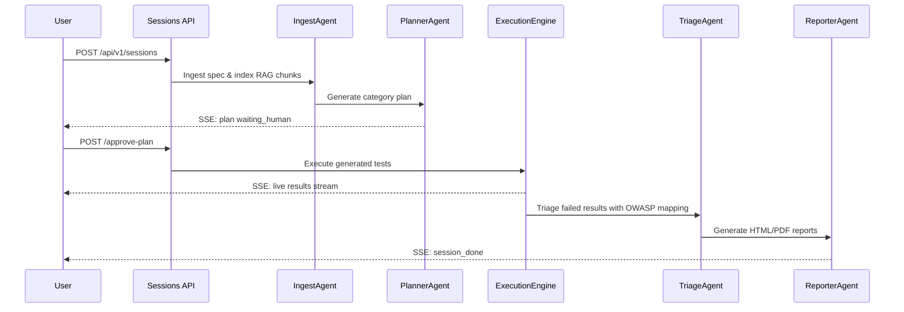

# Architecture & System Design

## Overview

The platform provides autonomous, AI-guided security and functional testing of REST APIs. It supports both cloud LLMs (OpenRouter, NVIDIA NIM) and local private LLMs (Ollama, LM Studio, llama.cpp), operates in two isolation modes (Local and Online), and supports both linear batch runs and agentic human-in-the-loop workflows.

---

## Execution Modes & Target Safety

| Feature | LOCAL Mode | ONLINE Mode |
|---|---|---|
| **Loopback (`127.0.0.1`, `localhost`)** | Allowed | **Blocked** |
| **Private RFC1918 (`10.*`, `172.16.*`, `192.168.*`)** | Allowed | **Blocked** |
| **Cloud Metadata (`169.254.169.254`)** | **Blocked** | **Blocked** |
| **Public Internet Hosts** | Blocked | Allowed |
| **Rate Limit** | User-defined / None | Max 2 requests/sec |
| **Max Concurrency** | Configurable (default 10) | Hard capped at 3 |
| **Attestation Required** | No | Yes, for security attacks |

---

## Pipeline Architectures

### 1. Legacy Linear Pipeline (`AGENTIC_MODE=false`)
- **Ingest & Parse**: OpenAPI/Postman parsed, endpoints extracted.
- **Generate**: Batch LLM test generation per category with duplicate suppression.
- **Execute**: Async HTTP execution pool with assertion evaluation.
- **Analyze**: LLM analyzes failure traces to separate real bugs from test bugs.
- **Report**: HTML, PDF, and JSON reports generated.

### 2. Agentic Pipeline (`AGENTIC_MODE=true`)

---

## RAG Knowledge Base

- **OWASP API Security Top 10 (2023)**: Original comprehensive guides (`API1:2023 BOLA` through `API10:2023 Unsafe Consumption`).
- **HTTP Standards KB**: Status codes, REST conventions, assertion patterns.
- **Spec Chunks**: Granular chunks of endpoints, parameters, and component schemas.
- **Run Memory**: Confirmed bugs and confirmed false positives recorded for few-shot prompt refinement.

